---
layout: default
title: KaaKazini User Guide
description: Step-by-step guidance for KaaKazini clients, craftsmen, and service providers.
---

# KaaKazini User Guide

##  For Craftsmen and Service Providers

This section explains how to register as a service provider, complete your profile, receive job requests, prepare quotations, complete jobs, track earnings, manage your schedule, and sell products on KaaKazini.

**Website:** https://kaakazini.com

## 7. Visiting the KaaKazini Homepage

The KaaKazini homepage is the starting point for clients looking for services and craftsmen who want to offer their skills.

1. Open your web browser.
2. Visit [https://kaakazini.com](https://kaakazini.com).
3. Explore the homepage to learn about the services available on KaaKazini.
4. If you want to offer your services, click **Join as a Provider** on the homepage or **Become a Provider** in the top navigation menu.
5. If you already have an account, select **Login** to access your account.

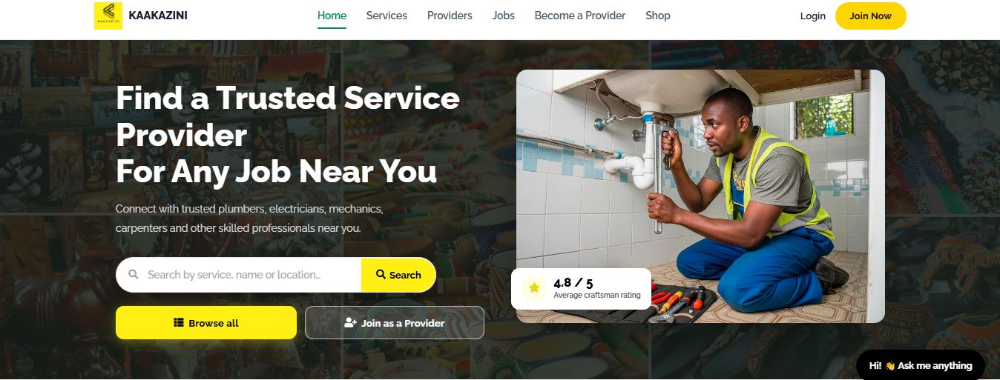

*Figure 12: KaaKazini homepage showing the main navigation and service provider entry point.*

---

## 8. Creating a Craftsman Account

To join KaaKazini as a craftsman or service provider:

1. Visit [https://kaakazini.com](https://kaakazini.com).
2. Click **Join as a Provider** on the homepage or **Become a Provider** in the top menu.
3. Enter your company or group name, email address, and Kenyan phone number in the format `2547XXXXXXXX`.
4. Create a password containing at least 8 characters and enter it again to confirm.
5. Click **Sign up**.
6. Complete any requested verification steps.
7. Log in to access your craftsman dashboard.

Use an active phone number and email address so you can receive account updates and job notifications.

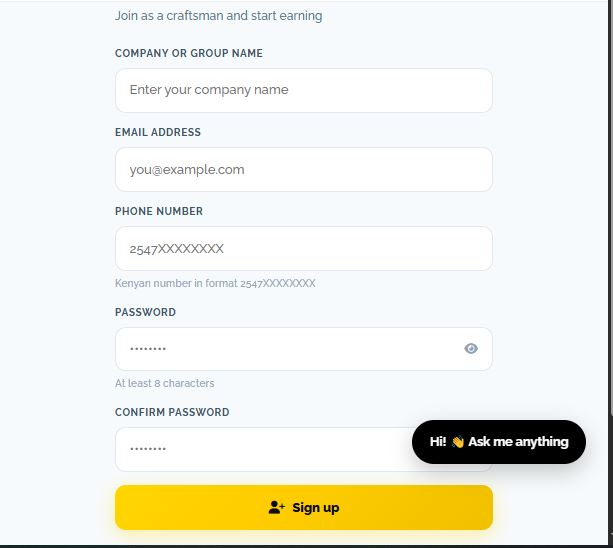
*Figure 12: Service provider sign-up form.*

---

## 9. Logging In to Your Craftsman Account

If you have already registered as a craftsman or service provider, log in to manage your profile, respond to job requests, prepare quotations, and monitor your work.

1. Visit [https://kaakazini.com](https://kaakazini.com).
2. Click **Login** in the navigation menu.
3. Enter the email address and password associated with your account.
4. Click **Login** or **Sign In** to continue.
5. If login is successful, open your craftsman dashboard to access your available features.

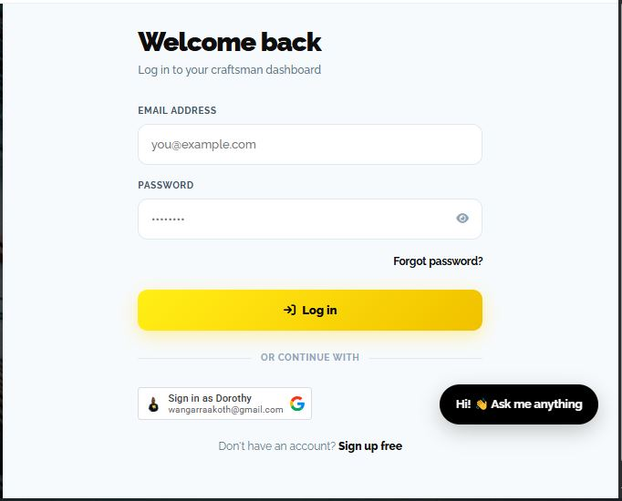

*Figure 13: KaaKazini login page.*

**If you cannot log in:**

- Check that your email address and password are correct.
- Check that your internet connection is working.
- Use the password reset option if you have forgotten your password, if available.
- Complete any verification steps requested by the platform.
- Contact KaaKazini support if the problem continues.

**New to KaaKazini?** Continue to the next section to create your craftsman account.

---

## 9. Completing Your Craftsman Profile

A complete profile helps clients understand your skills, experience, and services. It also helps KaaKazini assess your profile for approval.

Open **Profile** in the left-hand menu. The profile page contains seven sections, displayed as tags at the top. A section displays a yellow tick when it is complete.

Complete the following sections.

### 9.1 Profile Photo and Proof Document

- Upload a clear, recent photo of yourself or your business.
- Optionally upload a proof document, such as a certificate, identification document, or trade licence, to support verification.

Ensure that uploaded images and documents are clear and readable.

*Figure 13: Profile photo, optional proof document, and account type.*

### 9.2 Account Type

Choose the account type that best describes your business:

- **Individual:** Select this if you work independently.
- **Company:** Select this if you operate a business with a team.

### 9.3 About You

Write a short description explaining your experience, the work you specialise in, and what clients can expect from your services.

Keep the description clear, professional, and relevant to your trade.

### 9.4 Profession / Trade

Select the trade that best describes your work.

Choose carefully because changing your trade resets your selected specialisation and services.

### 9.5 Specialisation

Select the areas in which you specialise. You can choose more than one specialisation where applicable.

Your selections should reflect the work you are qualified and able to perform.

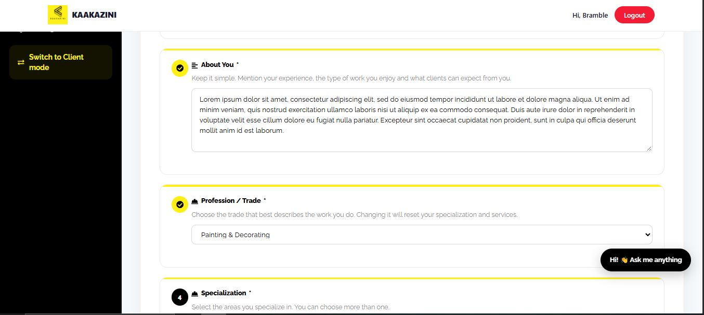

*Figure 14: About You and Profession / Trade sections.*

### 9.6 Services You Offer

Select the services you provide under your chosen trade and specialisation.

You may add rates where applicable. Rates are optional. If your price depends on the scope or complexity of a job, you can leave the rate blank and discuss the price with the client when preparing a quotation.

### 9.7 Your Area / Town

Enter the area or town where you provide services. Accurate location information helps clients find service providers who operate near them.

### 9.8 Work Photos

Upload photos of work you have completed to demonstrate your skills and experience.

- Use clear, genuine photos of your work.
- Choose images that represent the services you offer.
- Your first uploaded photo becomes your cover photo.
- Check the displayed upload count to see how many photos you have added.

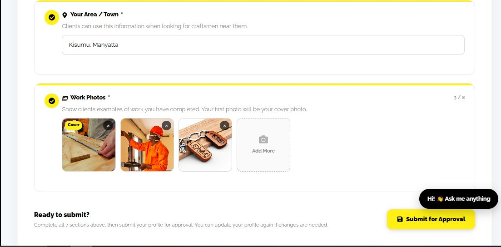

*Figure 16: Work Photos section and Submit for Approval button.*

Once all seven sections are complete, review your profile before submitting it.

---

## 10. Profile Verification and Approval

After completing your profile, submit it for review.

1. Check that all seven profile sections are complete.
2. Ensure that your profile details and work photos are accurate.
3. Provide any requested verification documents.
4. Click **Submit for Approval**.
5. Check your dashboard or notifications for updates.
6. If changes are requested, update your profile and submit it again.

When your profile is approved, a **Verified** badge appears on your profile, and clients can find and book you according to the platform's applicable rules.

You can update your profile whenever your information, services, or work portfolio changes.

*Note: Approval and job eligibility depend on KaaKazini's current platform rules.*

---

## 11. Receiving and Responding to Job Requests

The **Jobs** section allows you to manage your work orders and review jobs assigned to you.

### 11.1 Viewing Your Work Orders

1. Log in to your craftsman dashboard.
2. Click **Jobs** in the left-hand menu.
3. Use **All Jobs**, **Active**, or **Completed** to filter your work orders.
4. Click **View** on a job to open its details.
5. Review the service, location, scheduled date, description, and budget.
6. Click **Accept Job** or **Decline**, depending on your availability.

Each job card displays relevant information, such as its status, budget, location, and client name.

Possible status labels include **Assigned to You**, **Awaiting Confirmation**, **Quote Approved**, **In Progress**, and **Paid & Closed**.

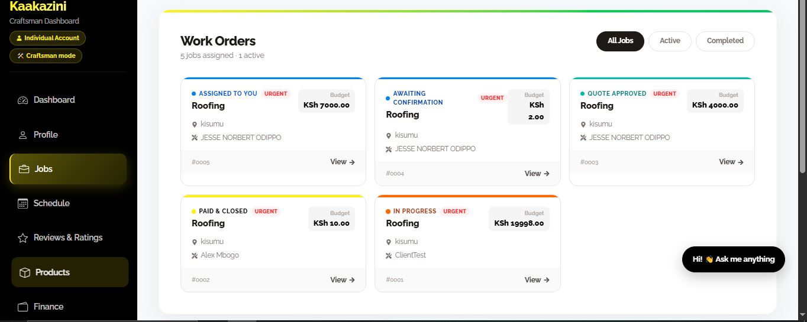

*Figure 17: Work Orders list showing job status, budget, and location.*

### 11.2 Reviewing an Assigned Job

Inside a job, the progress bar shows the job's current stage:

**Assigned → Accepted → Quoted → Approved → In Progress → Done → Paid**

Review the job details carefully before accepting it.

The client's phone number remains hidden until you accept the job.

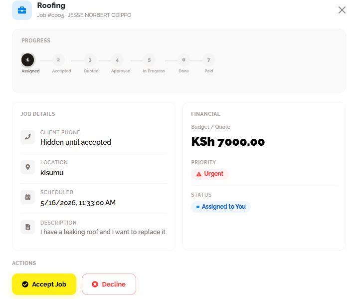

*Figure 18: Newly assigned job with Accept Job and Decline buttons.*

**Important:** Only accept jobs you are qualified and available to complete.

---

## 12. Quoting and Completing a Job

### 12.1 After You Accept the Job

Once you accept a job:

- The client's phone number becomes visible.
- The progress bar moves to **Accepted**.
- You can contact the client, send a message, or prepare your quotation.

Use this stage to clarify the client's requirements before finalising your price.

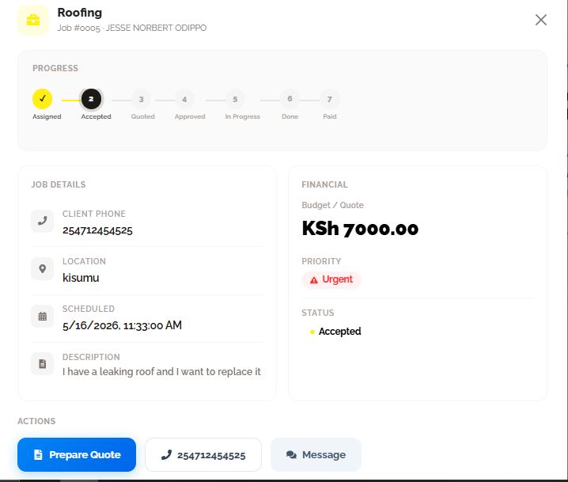

*Figure 19: Accepted job with Prepare Quote, call, and Message buttons.*

### 12.2 Preparing Your Quotation

Click **Prepare Quote** to create a quotation for the client.

Complete the quotation form as follows:

1. **Name or business name:** Check that the correct details are displayed.
2. **Line Items:** Enter a description of each item or task, its quantity, and unit price in Kenyan shillings (KSh).
3. **Add Item:** Click this button to add more line items.
4. **Work Type:** Select the appropriate work type.
5. **Duration:** Enter the estimated time required, such as two days.
6. **Payment Terms:** Specify the agreed payment arrangement, for example, a 50% deposit and 50% on completion.
7. **Notes:** Add warranties, exclusions, or other special terms where applicable.
8. **Quote Total:** Review the calculated total to ensure it accurately reflects your line items.
9. Click **Submit Quote** when the quotation is ready.

Make sure the quotation clearly describes the work and the amount the client is expected to pay.

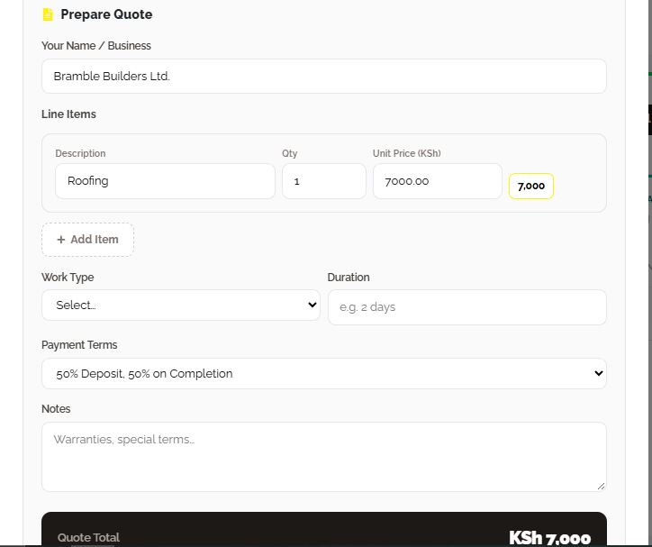

*Figure 21: Quote total with Download PDF, Cancel, and Submit Quote buttons.*

### 12.3 Downloading Your Quotation as a PDF

Click **Download PDF** to save a copy of your quotation.

The quotation PDF includes details such as:

- Your name or business name.
- The client details.
- Quote number and date.
- Line items and prices.
- Total quotation amount.
- Payment terms.
- Estimated duration.

Keep a copy for your records.

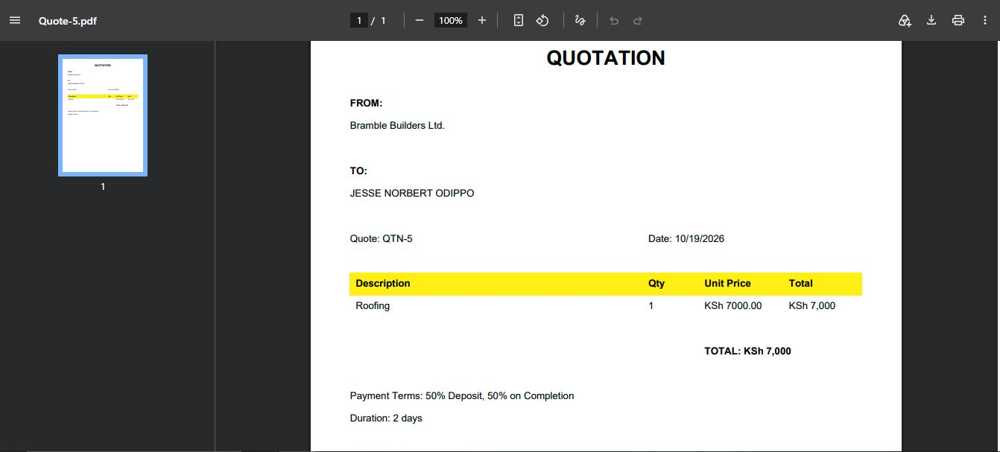

*Figure 22: Example quotation PDF, QTN-5.*

### 12.4 Sending the Quotation to the Client

After submitting your quotation, select the preferred method for sharing it.

- **Email:** Sends the quotation PDF as an attachment.
- **SMS:** Sends a text message containing a link to the quotation.
- **WhatsApp:** Opens a pre-filled WhatsApp message.
- **Download Only:** Saves the PDF so you can share it yourself.

Select the appropriate option and click the corresponding send button, such as **Send Email**.

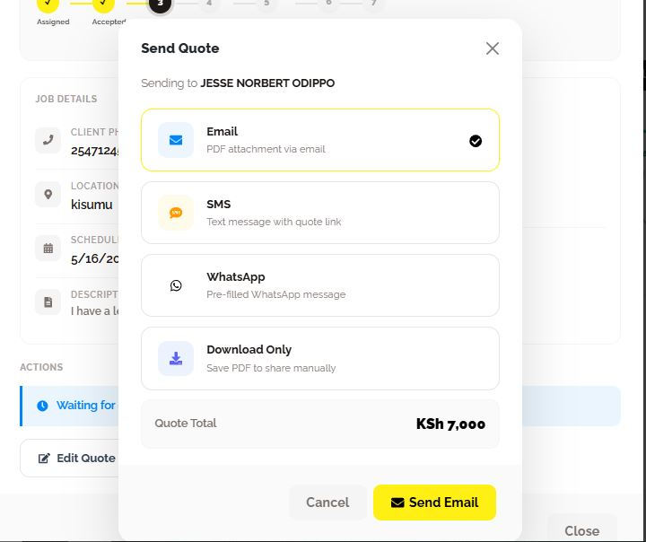

*Figure 23: Quotation delivery options: Email, SMS, WhatsApp, and Download Only.*

### 12.5 Waiting for Client Approval

After sending your quotation, the job displays a status indicating that you are waiting for the client to approve it.

At this stage:

- Wait for the client to review the quotation.
- Click **Edit Quote** if you need to make changes.
- Click **Resend Quote** if you need to send the quotation again.

Make sure any revised quotation reflects the agreed scope and pricing.

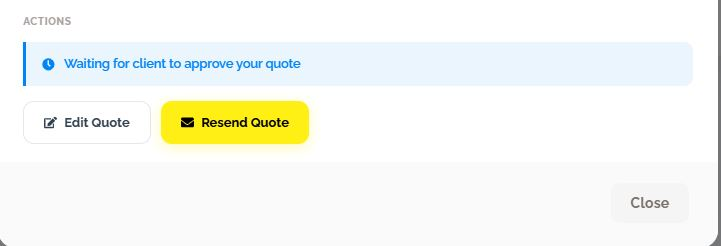

*Figure 24: Waiting for client approval, with Edit Quote and Resend Quote buttons.*

### 12.6 Completing the Agreed Work

Once the client approves your quotation, the job status changes to **Approved**.

Follow these steps:

1. Coordinate with the client by phone or through Messages.
2. Confirm the agreed work, location, and schedule.
3. Travel to the agreed location when required.
4. Perform the work according to the approved quotation.
5. Update the job status to **In Progress** when work begins.
6. When the work is complete, update the status to **Done**.
7. Follow the platform's required completion and payment workflow.

Keep the client informed if there are changes to the schedule or scope of work.

---

## 13. Getting Paid and Earning on KaaKazini

Your earnings come from providing services to clients under the agreed quotation and payment terms.

To manage a completed job:

1. Complete the accepted job.
2. Mark the job as **Done** using the available controls.
3. Follow the payment process described in your quotation.
4. Monitor the job until it reaches **Paid**, the final stage on the progress bar.
5. Check your available earnings and payment information.
6. Keep records of completed jobs, quotations, and payment confirmations.

Payment timing, transaction charges, and payout arrangements depend on the platform's configured payment process and applicable terms.

### 13.1 Viewing Your Work Schedule

Click **Schedule** in the left-hand menu to view your work schedule.

The page organises your jobs into:

- **Today**
- **Tomorrow**
- **Upcoming**

Jobs assigned to you with a date and time appear in the schedule automatically.

Use the navigation arrows to move between days and review your upcoming commitments.

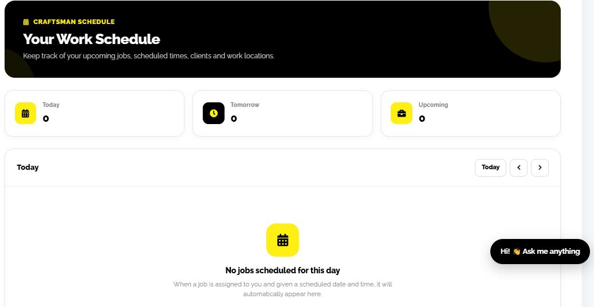

*Figure 25: Your Work Schedule page.*

### 13.2 Tracking Your Earnings and Performance

Click **Analytics** in the left-hand menu to review your work and performance.

The analytics page displays:

- **Total Earnings:** Your earnings over the selected period.
- **Jobs Completed:** The number of jobs completed.
- **Average Rating:** Your average client rating.
- **Completion Rate:** Your job completion performance.
- **Earnings Chart:** A visual representation of earnings over time.

Use **1M**, **3M**, **6M**, or **1Y** to change the reporting period.

Review these indicators to understand your performance and monitor your progress.

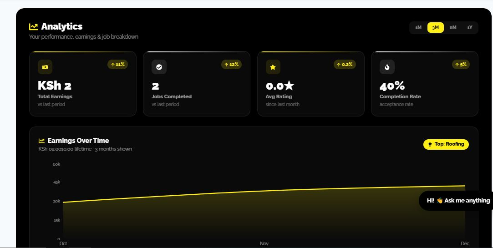

*Figure 26: Analytics page showing earnings, completed jobs, average rating, and completion rate.*

### 13.3 Selling Products on KaaKazini

KaaKazini also allows eligible service providers to submit products for sale, such as paints or wooden products.

To add a product:

1. Click **Products** in the left-hand menu.
2. Click **+ Add Product**.
3. Enter the requested product information.
4. Submit the product for review.
5. Wait for administrator approval before expecting it to appear as a live product.

You can also search your products, filter them by category or status, and use the available **Edit** or **Delete** actions.

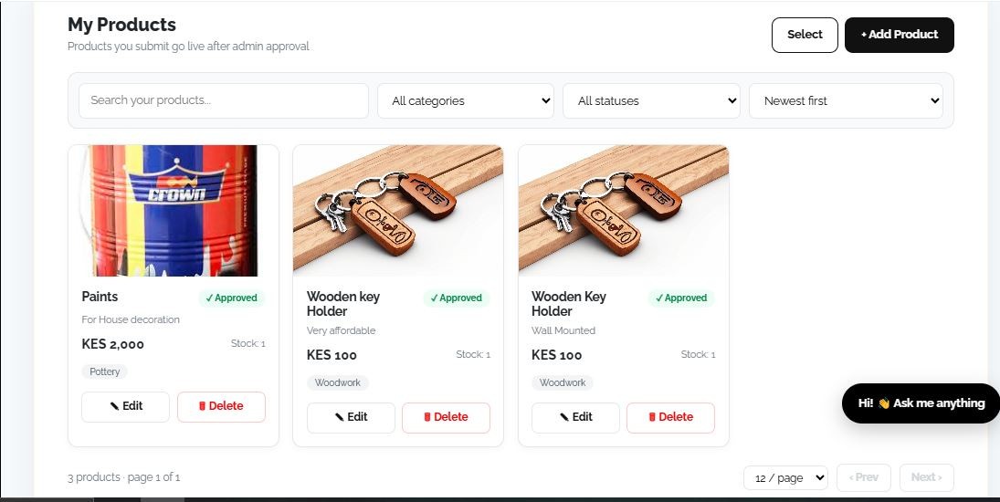

*Figure 27: My Products page showing approved products.*

---

## 14. Best Practices for Craftsmen and Service Providers

To build a strong reputation and improve your experience on KaaKazini:

- Keep your profile information accurate and current.
- Upload clear, genuine photos of your work.
- Specify the services you are qualified to provide.
- Keep your availability and service area accurate.
- Respond to job requests promptly.
- Send clear quotations covering scope, price, duration, and payment terms.
- Communicate professionally with clients.
- Update job statuses accurately.
- Keep copies of quotations and payment confirmations.
- Follow KaaKazini's payment and platform policies.

A complete profile, clear quotations, reliable communication, and quality work help clients make informed decisions when choosing a service provider.

---

**End of Part A: For Craftsmen and Service Providers**

